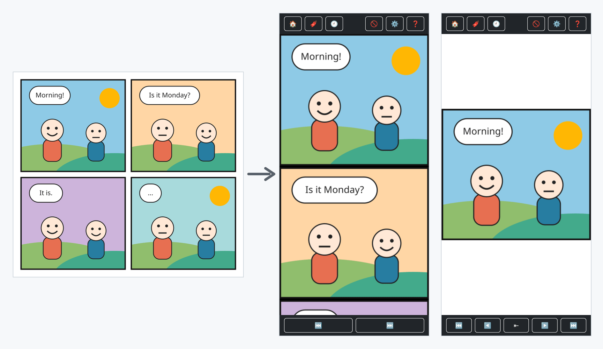

# Ausschnitt

Ausschnitt is a self-hosted webcomic reader designed for phones. It downloads pages from a comic's website, detects and splits pages into individual panels, and presents them in a panel-by-panel or continuous-scroll reader. It is installable as a Progressive Web App (PWA).

Teach Ausschnitt the image and navigation elements for a comic once, then it can crawl and cache pages as you read. One account can be used privately, or you can enable multiple accounts during first-run setup. Accounts share each comic's downloaded cache while keeping reading positions, settings, ignored pages, and bookmarks separate.



*The sample comic in these screenshots is made up for this README.*

## Features

- Automatic panel detection and splitting, with a whole-page fallback when a layout is unclear
- Panel-by-panel and continuous-scroll reading modes
- Per-account reading positions, bookmarks, ignored pages, and settings
- Optional multiple accounts with password-protected profiles
- Shared comic downloads between accounts on the same instance
- Optional new-page notifications via Web Push
- Installable PWA with an offline fallback page
- SQLite storage and local image files; no external database required
- A built-in manual (the ❓ button), shown automatically on each account's first login

## Limitations

- **Sites must work without JavaScript.** Pages are fetched as plain HTML and their scripts never run, so a comic whose image or navigation links are created by JavaScript can't be read.
- **No bot protection or logins.** Sites behind a challenge page (such as Cloudflare's "checking your browser") or a login wall can't be fetched.
- **Panel splitting needs gutters.** Pages are split where the panels are separated by gaps in the page's background color. Pages without such gaps, or with irregular layouts, stay whole - you still read them, just not panel by panel.

Improvements are welcome - see [Contributing](#contributing).

## Run Locally

Requirements: Node.js 24 or newer (26 recommended) and npm. `better-sqlite3` and `sharp` include native components, so use a supported Node.js version and install dependencies on the machine that will run the app.

```sh
npm ci
npm run build
npm start
```

Open [http://localhost:3000](http://localhost:3000). On first launch, complete the setup wizard to choose single-user or multi-user mode. Add a comic by its website URL, then use **Select Elements** to identify its page image and navigation links. The built-in manual (❓ in the top bar) walks through all of this and explains every reader button.

The app listens on `0.0.0.0:3000` by default. Set `PORT` or `HOST` to override the port or bind address. Runtime data is stored in `data/` next to the project, including `ausschnitt.db` and downloaded panel images under `data/images/`.

Run the test suite with:

```sh
npm test
```

## Docker

The included Dockerfile builds and tests the app in a Node.js 26 container. Start it with:

```sh
docker compose up -d --build
```

The app is then reachable on port `3333` of the host. Data (the database and downloaded panels) is stored in `./data` next to the Compose file; back up that directory. It must be writable by the container's `node` user (UID 1000).

These settings can be changed without editing the Compose file, through environment variables or a `.env` file next to it:

| Variable | Default | Meaning |
|---|---|---|
| `AUSSCHNITT_PORT` | `3333` | Port on the host. |
| `AUSSCHNITT_DATA` | `./data` | Host folder for the database and panels. |
| `BEHIND_HTTPS_PROXY` | `false` | Set to `true` only behind a TLS-terminating reverse proxy that forwards `X-Forwarded-Proto`. Over plain HTTP, `true` prevents logging in, because session cookies are then only sent over HTTPS. |

For example, a `.env` file:

```sh
AUSSCHNITT_PORT=8080
AUSSCHNITT_DATA=/srv/ausschnitt/data
```

## Portainer

No prebuilt image is published, so the image has to be built from this repository's source. Pasting the Compose file into Portainer's web editor alone doesn't work: its `build: .` line needs the source code next to it.

Either way, first create a data folder on the Docker host that the container can write to (UID 1000):

```sh
sudo mkdir -p /srv/ausschnitt/data
sudo chown 1000:1000 /srv/ausschnitt/data
```

### Option 1: Build from the Git repository (recommended)

Portainer clones the repository and builds the image itself. The Compose file comes from the repository and can't be edited in Portainer; it's configured through the stack's environment variables instead.

1. In Portainer, go to **Stacks** > **Add stack** and give it a name, for example `ausschnitt`.
2. Choose **Repository** as the build method.
3. Enter `https://github.com/tstrube/ausschnitt` as **Repository URL**, keep `refs/heads/main` as the reference, and keep `docker-compose.yml` as the **Compose path**.
4. Under **Environment variables**, add:
   - `AUSSCHNITT_DATA` = `/srv/ausschnitt/data` (always set this - the default `./data` would end up inside Portainer's copy of the repository, a folder that's hard to find for backups)
   - `AUSSCHNITT_PORT` = the port you want, if not `3333`
   - `BEHIND_HTTPS_PROXY` = `true`, only behind an HTTPS reverse proxy (see [Docker](#docker))
5. Click **Deploy the stack**.

To update, open the stack and click **Pull and redeploy**. The environment variables can be changed there too.

### Option 2: Build the image on the host, deploy with the web editor

This gives a stack whose Compose file you can edit in Portainer.

1. On the Docker host, clone the repository and build the image:

   ```sh
   git clone https://github.com/tstrube/ausschnitt.git
   cd ausschnitt
   docker build -t ausschnitt:latest .
   ```

2. In Portainer, go to **Stacks** > **Add stack**, choose **Web editor**, and paste this Compose file. It uses the image you just built instead of building one:

   ```yaml
   services:
     ausschnitt:
       image: ausschnitt:latest
       container_name: ausschnitt
       restart: unless-stopped
       ports:
         - "3333:3000"
       volumes:
         - /srv/ausschnitt/data:/app/data
       environment:
         - BEHIND_HTTPS_PROXY=false
   ```

   Change `3333` to publish the app on another port.

3. Click **Deploy the stack**.

To update, run `git pull` and `docker build -t ausschnitt:latest .` again on the host, then open the stack in Portainer and click **Update the stack**.

## Security

**Single-user mode has no login.** Anyone who can reach the app has full access to it, including the admin functions and the page preview used by Select Elements, which fetches web pages on the server's behalf. Use single-user mode only on a trusted home network or behind a VPN.

If the app is reachable from the internet, choose multi-user mode during setup (every account has a password) and put it behind a reverse proxy with HTTPS, with `BEHIND_HTTPS_PROXY=true` (see [Docker](#docker)).

Logins are rate-limited: after 10 failed attempts from one address within 15 minutes, further attempts are refused until the 15 minutes are over. The session cookie isn't sent with requests started by other websites, which protects against cross-site request forgery.

## Backup and Updating

Everything Ausschnitt stores is in its data folder (`./data`, or `AUSSCHNITT_DATA`): the database `ausschnitt.db` and the downloaded panels in `images/`. To back up, stop the container and copy that folder. Downloaded panels can always be fetched again, so the database alone keeps all accounts, comics, reading positions, and bookmarks.

To update with Docker Compose:

```sh
git pull
docker compose up -d --build
```

For Portainer, see the update steps under [Portainer](#portainer).

## How It Works

Ausschnitt uses Express 5 and server-rendered Pug views, with plain JavaScript for browser interactions. TypeScript is compiled to `dist/`; SQLite stores comic metadata, accounts, and reading state, while panel images are stored on disk. Comic pages are fetched from the comic's own website using selectors configured in the app.

The project does not include comic content. Only add comics you are authorized to access, and respect the comic site's terms and resource limits.

## How Comic Sites Are Treated

Ausschnitt is meant to read a comic the way a person would, not to mirror its site:

- **Only what's needed is fetched**: a page's HTML and its comic image. Stylesheets, scripts, ads, and other images on the page are never downloaded by the server.
- **Each page is downloaded once.** Its panels are stored locally and served from there, and every account on the same instance shares them. A page is only fetched again after its comic's downloads were cleared, or to see whether a comic's homepage shows a new strip.
- **Pages are fetched while you read**, plus up to 5 pages ahead in the background so the next page is ready. Once read-ahead reaches the newest page, it waits 3 minutes before asking the site again.
- **At most one request per site every half second**, however many people are reading or how much is being crawled in the background.
- **Requests identify themselves** with the User-Agent `Ausschnitt (+https://github.com/tstrube/ausschnitt)`, so site owners can tell what is visiting and where to find out more.
- **New-page checks are opt-in.** A comic is only checked for new pages if someone turned on notifications on a device and hasn't muted that comic, and then at most once per check interval (every 6 hours by default, configurable or off in Settings).
- **Navigation never leaves the comic's site.** A link that points to another domain is not followed.
- **Nothing is circumvented.** Ausschnitt doesn't solve bot challenges, log in, or disguise itself as a browser; a site that blocks it stays blocked.

While you use **Select Elements**, the comic's page is shown through the app so it can be clicked inside a frame. The server fetches only that page's HTML; your browser loads the rest of the page from the comic's site as usual.

## Contributing

Pull requests are welcome, especially ones that make Ausschnitt work with more comic sites: navigation that isn't found, pages that crawl wrong, or panels that split badly.

**No real comics in the repository - ever.** Comics are copyrighted, so code, comments, tests, documentation, commit messages, and pull request descriptions must not contain any comic's name, URL, domain, images, or markup copied from its site. Pull requests that include any of these will not be merged.

Issues are different: when reporting a site that doesn't work, you may name the comic and link to it - that's usually the quickest way to reproduce the problem. Please still don't upload images or screenshots of comic pages. A pull request may reference such an issue ("Fixes #12"), but its own content follows the rule above.

In a pull request, reproduce the problem synthetically:

- **Navigation and crawling**: write a minimal HTML fixture with made-up ids, classes, and links that shows the same structure (for example, "the Next link is a disabled `<a href="#">` on the newest page"). See `src/utils/matchSelector.test.ts`.
- **Panel splitting**: build a synthetic image from plain colored rectangles that recreates the layout (gutter widths, a title bar, a frame color). See `src/utils/panelSplitter.test.ts`.

Run `npm test` before opening a pull request; CI runs the tests and the Docker build on every pull request.

To report a site that doesn't work, use the **A comic site doesn't work** issue template.

## License

Licensed under the GNU Affero General Public License, version 3 or (at your option) any later version. See [LICENSE](LICENSE).

You may use, modify, and self-host Ausschnitt freely. If you run a modified version that other people use over a network, you must offer them its complete source code under the same license.